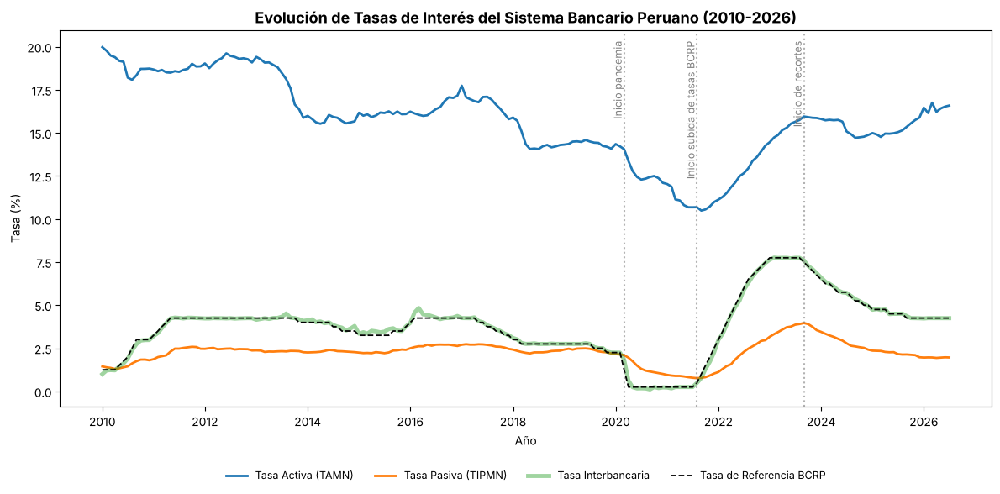
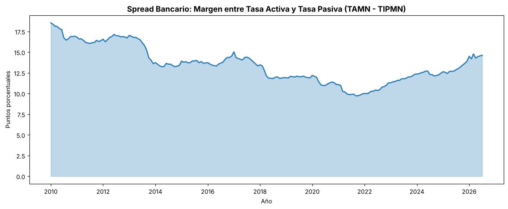
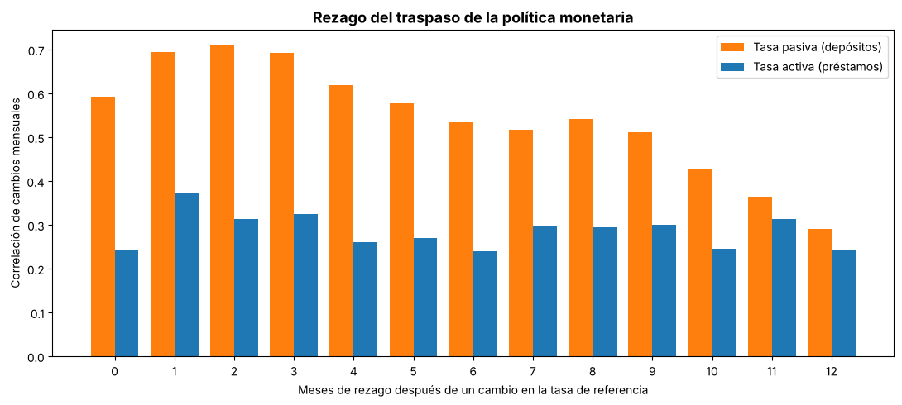
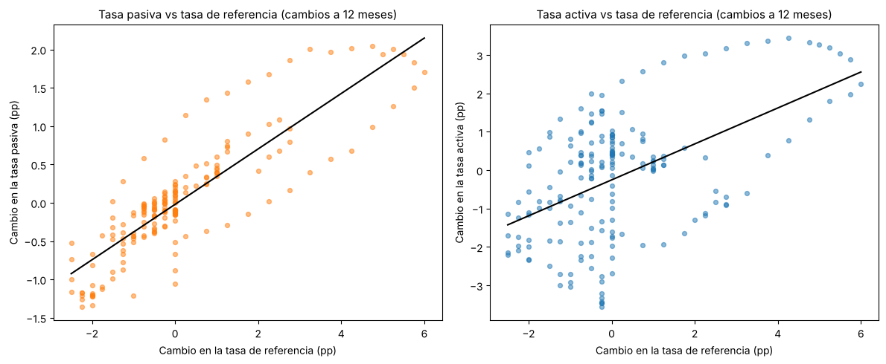

# 🏦 Tasas de Interés del Sistema Bancario Peruano (2010-2026)

**En una línea:** con 16 años de datos del BCRP medí **cuánto y con qué rezago** las decisiones de política monetaria llegan a las tasas de depósitos y de préstamos, y cómo ha cambiado la brecha entre ambas (spread).

**Stack:** Python · pandas · matplotlib · statsmodels

---

## 🎯 Problema
Cuando el Banco Central cambia su tasa de referencia, ¿qué tan rápido y qué tan completo es el efecto sobre lo que los bancos pagan por depósitos y cobran por préstamos? ¿Y cómo evolucionó la brecha entre ambas tasas?

## 🔧 Qué hice
1. **Extracción y limpieza:** 4 series mensuales del BCRP (enero 2010 a julio 2026, **199 registros, 0 nulos**), con fechas en español convertidas y unidas por fecha.
2. **Spread:** Tasa Activa − Tasa Pasiva, como aproximación a la brecha de intermediación.
3. **Rezagos:** correlacioné los **cambios mensuales** de la tasa de referencia con los de la tasa pasiva y activa a 0–12 meses.
4. **Traspaso a 12 meses:** regresión de los cambios a 12 meses de cada tasa contra el de la tasa de referencia, con errores robustos (HAC) por el solapamiento de las ventanas.
5. **Asimetría:** separé subidas (57 meses) y bajadas (97 meses) y probé si el traspaso es igual en ambos sentidos.

> **Por qué no usé correlación en niveles:** la correlación de niveles entre tasa activa y referencia (0.27) no mide el traspaso, porque son series con tendencia. Por eso el análisis se hace sobre cambios.

## ✅ Resultados

| Hallazgo | Evidencia |
|---|---|
| La tasa interbancaria sigue a la de referencia casi exactamente | correlación 0.998; brecha promedio 0.07 pp |
| **Los depósitos siguen a la política monetaria de cerca** | +1 pp en la tasa de referencia → **+0.36 pp** en la tasa pasiva a 12 meses (IC 95%: 0.27–0.45); la política explica **74%** de su variación; efecto máximo a los **2 meses** |
| **Los préstamos dependen de mucho más que la política monetaria** | +1 pp → **+0.47 pp** en la tasa activa (IC 95%: 0.24–0.70); la política explica solo **27%** |
| Los depósitos suben menos de lo que bajan | traspaso de **0.32 al subir vs 0.48 al bajar** (p = 0.015); en préstamos no hay diferencia (p = 0.90) |
| El spread cayó 25% entre 2010 y 2025, pero se recupera desde 2021 | 17.4 → 13.0 pp (promedios anuales); mínimo de 9.7 pp en sep-2021; **14.5 pp** en 2026 |









## ⚠️ Limitaciones
- **El spread es una aproximación:** TAMN − TIPMN no incluye costos, morosidad, comisiones ni composición de la cartera; no es el margen contable de los bancos.
- **Promedios del sistema:** no se distingue entre bancos, productos ni plazos.
- **Pocos ciclos de política monetaria:** la asimetría en depósitos es una asociación, no prueba causalidad.
- **Causas del spread:** competencia, regulación o riesgo son hipótesis; este proyecto no las prueba.

## 🚀 Cómo ejecutarlo
```bash
pip install pandas matplotlib statsmodels jupyter
jupyter notebook analisis_tasas_bancarias.ipynb
```
El notebook lee `data/tasas_bancarias_peru_2010_2026.csv`. También funciona en Google Colab subiendo el CSV a una carpeta `data/`.

## 📁 Estructura
```
├── data/
│   └── tasas_bancarias_peru_2010_2026.csv
├── images/
│   ├── grafico_1_evolucion_tasas.png
│   ├── grafico_2_spread_bancario.png
│   ├── grafico_3_rezagos.png
│   └── grafico_4_traspaso_12m.png
├── analisis_tasas_bancarias.ipynb
└── README.md
```

## 📚 Fuente de datos
[BCRP - Estadísticas Económicas](https://estadisticas.bcrp.gob.pe/estadisticas/series/): series `PN07807NM`, `PN07816NM`, `PN07819NM`, `PD04722MM`.

## 💡 Aplicación
- **Gestión de riesgo y planificación financiera:** anticipar cuánto y en qué plazo se moverían las tasas de depósitos y préstamos ante un cambio de política monetaria.
- **Análisis de política monetaria:** medir qué tan completo y rápido es el traspaso hacia el crédito real.
- **Siguiente paso:** pronóstico de tasas (ARIMA, Prophet) y un dashboard en Power BI con estas series.

---

## 👤 Autor
**Héctor Estéfano Gómez Vigo** · Estudiante de Estadística e Informática (UNALM)
[LinkedIn](https://www.linkedin.com/in/h%C3%A9ctor-est%C3%A9fano-g%C3%B3mez-9b6079289/)
